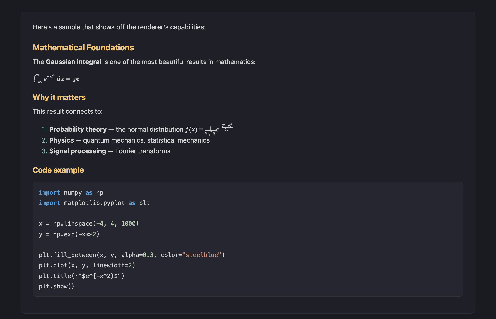
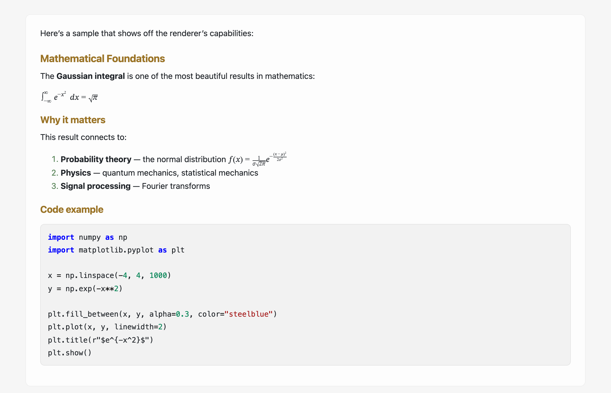
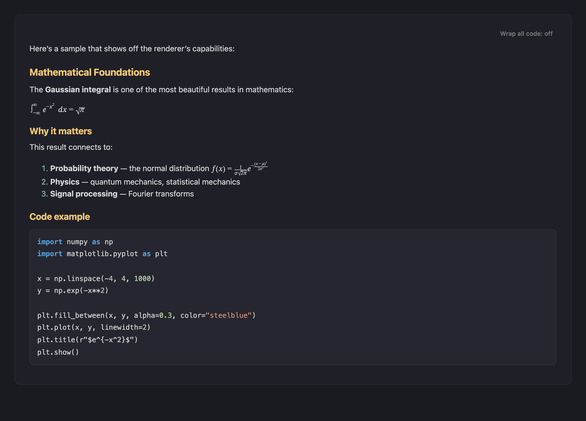
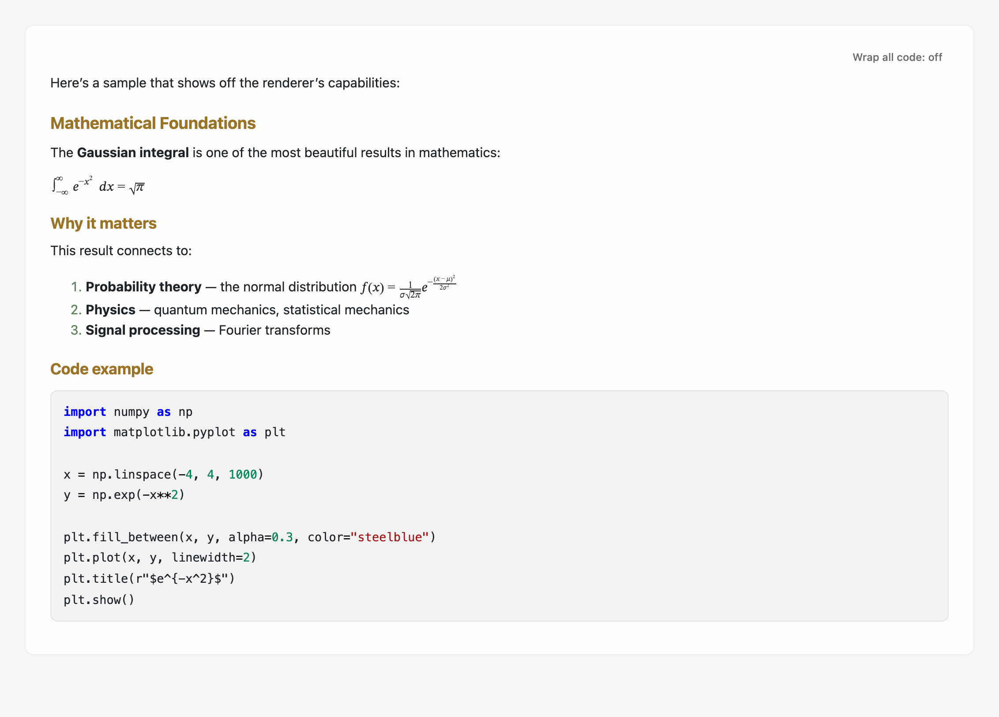
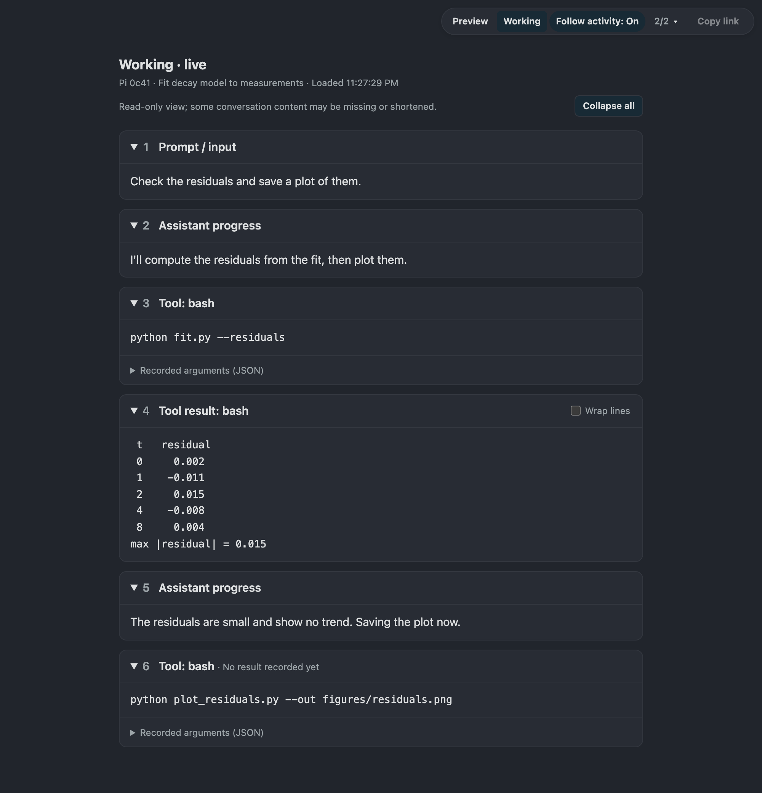
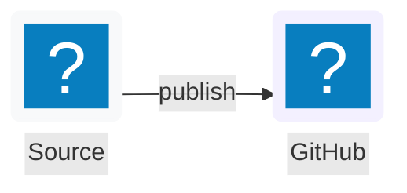

# pi-markdown-preview

Preview assistant responses and local Markdown, LaTeX, code and diff files from [pi](https://pi.dev) in the terminal, in the browser or as PDF, with math, syntax highlighting, Mermaid diagrams and colours from your Pi theme. A browser preview can also follow each turn live, showing prompts, tool calls and results as Pi records them.

## Screenshots

Previews follow your Pi theme. Examples with a custom theme and the built-in defaults:

**Terminal preview (custom theme):**


**Terminal preview (default dark):**



**Terminal preview (default light):**



**Browser preview (default dark and light):**

| Default dark | Default light |
|:--:|:--:|
|  |  |

## Install

```bash
pi install npm:pi-markdown-preview
```

Or install from GitHub with `pi install https://github.com/omaclaren/pi-markdown-preview`, or try it without installing with `pi -e https://github.com/omaclaren/pi-markdown-preview`.

You need [Pandoc](https://pandoc.org/installing.html) (`brew install pandoc` on macOS). Terminal previews also need a Chromium-based browser (Chrome, Brave, Edge or Chromium) and a terminal that can show images (Ghostty, Kitty, iTerm2 or WezTerm). PDF export needs a LaTeX engine such as [TeX Live](https://tug.org/texlive/) (`brew install --cask mactex` on macOS, `apt install texlive` on Linux), and Mermaid diagrams in PDF need Mermaid CLI (`npm install -g @mermaid-js/mermaid-cli`). PDF icon nodes require Mermaid CLI 11.6+.

Previews load Mermaid, the MathJax fallback, Mermaid icon packs and PDF.js from jsDelivr or unpkg the first time a page needs them, so those features need network access.

## Quick start

`/preview` shows the latest response in the terminal. To keep a browser tab alongside the session, run:

```text
/preview-browser --live
```

The tab shows each response when Pi finishes it, with earlier responses a click away. **Working**, beside each response, shows the prompts, tool calls and results that led to it. Turn on **Follow activity** in the toolbar (or press Ctrl+Alt+A) to watch each turn in Working as it runs; when the turn finishes, the page returns to the response. With Follow activity off, the tab updates after each turn.



Working shows recorded prompts and tool output to anyone with the tab's link. For responses only, use `/preview-browser --watch` instead.

## Usage

| Command | Description |
|---------|-------------|
| `/preview` | Preview the latest response in the terminal |
| `/preview --pick` | Choose from all assistant responses |
| `/preview <path/to/file>` | Preview a Markdown, LaTeX, diff or code file |
| `/preview --file <path/to/file>` | The same, for dash-prefixed or reserved filenames |
| `/preview --browser` (`-b`) | Open in a cmux browser split when available, otherwise the system browser |
| `/preview --font-size 14` | Font size in px (defaults: terminal 16, browser 15) |
| `/preview --pick --browser` | Choose a response and open it in the browser |
| `/preview-browser --live` | Browser tab that follows the session, with Working and [Live](#live-and-working) |
| `/preview-browser --working` | The same without Live |
| `/preview-browser --watch` (`-w`) | Browser tab that updates after each response, without Working |
| `/preview-browser --watch <path>` | Browser tab that follows a file |
| `/preview-browser --watch --history 5` | Start with up to 5 earlier responses (default 10, 0–20) |
| `/preview-browser` | One-shot browser preview |
| `/preview-browser <path/to/file>` | One-shot browser preview of a file |
| `/preview-browser --list` | List browser watchers |
| `/preview-browser --stop <path>` | Stop one file watcher |
| `/preview-browser --stop --responses` | Stop the response watcher |
| `/preview-browser --stop --all` | Stop every watcher in this Pi session |
| `/preview-browser --stop` | Stop the only watcher; with several running, name one |
| `/preview --pdf` | Export to PDF and open it |
| `/preview-pdf` | Shortcut for `--pdf` |
| `/preview --pdf <path/to/file>` | Export a file to PDF |
| `/preview-clear-cache` | Clear the preview cache |

`/preview -b -w` is the same as `/preview-browser -w`. Paths can be quoted. Other short forms and aliases are listed in [details](docs/details.md#argument-aliases).

### Live and Working

Working shows a response's recorded prompts, progress, any exposed reasoning, and its tool calls and results. Prompts start expanded and activity starts folded. Commands, file reads and edits have readable views, with the recorded JSON available, and recorded images can be enlarged. **Ctrl+Alt+P** and **Ctrl+Alt+W** (Control+Option on macOS) switch between Preview and Working.

With `--live` and **Follow activity** on, the page moves to Working when a turn starts and back to Preview when it ends. If you have scrolled up or moved to another page, it leaves you there. Updates arrive as Pi records each message, not token by token, so a tool call shows "No result recorded yet" until its result is recorded. Pi Studio has a fuller live view.

**Privacy:** prompts, tool output and recorded images can contain secrets, and nothing is redacted. Share these links only with people you trust. Working stays on until you stop the watcher. To start it with a fresh link, first stop any response watcher already running (`/preview-browser --stop --responses`).

Some content may be shortened or left out; [details](docs/details.md#working) lists what Working reads and its limits.

### Browser watch mode

A response watcher renders each response once Pi finishes it. It starts with the last 10 finished responses on the current branch and keeps up to 20. Step through them with **Previous**, **Next** and **Latest** in the **current/total ▾** counter menu, with the browser's Back and Forward buttons, or with **Option/Alt+Left/Right** (add **Shift** for the oldest or latest). On an older response the page stays put and marks **New** when something arrives. For responses from before the watcher started, use `/preview --pick --browser`.

A file watcher re-renders when the file changes, keeps your reading position, and keeps the last good preview if a render fails.

Each Pi session can run up to eight watchers: one for responses and the rest for files. Running a command again for the same source reopens its watcher. Watchers stop with `--stop` or when the Pi session ends; a page whose watcher has stopped says it is disconnected.

The page drops its token from the address bar after the first load, so a copied address won't open in another browser. Use **Copy link** in the toolbar instead. Inside cmux, browser previews open as a split in the caller's workspace.

### Links to local files

In a watched preview, links to local files open in the same tab, and Back returns you to where you were. Relative links in a response resolve against Pi's working directory, and links inside a file against the file's directory. Markdown, LaTeX, text and code open as rendered snapshots (refresh to reread them). Images, PDFs and HTML pages open in the browser, with HTML run in a sandbox. Other files and folders open a page with buttons to show them in their folder, open them in their default app, or copy the path. Each link also has **Copy local path** and **⋯ File actions** beside it.

These actions run on the machine hosting the preview, and opening a file in its default app can run it. Anyone with a watcher's link can use them, so share the link only with people you trust. [Details](docs/details.md#security) describes what a watcher serves.

### Figures, cross-references and Mermaid icons

Local images and PDF figures resolve relative to the previewed file or, for responses, to Pi's working directory. Figure cross-references in Quarto syntax (`{#fig-elephant}` with `@fig-elephant`) or pandoc-crossref syntax (`{#fig:elephant}` with `@fig:elephant`) produce numbered captions and clickable **Figure N** references, for standalone captioned images and single references. No Quarto code is run; use Quarto itself for subfigures, filters or execution. `<sup>`/`<sub>` tags and Pandoc's `^1^` and `~2~` work, and HTML comments in Markdown are hidden.

### Mermaid icons

Mermaid flowcharts can use `lucide:*` and `logos:*` icons. Keep each icon declaration on one line:



### Terminal preview and code wrapping

| Key | Action |
|-----|--------|
| `←` / `→` | Previous or next page |
| `r` | Re-render, bypassing the cache |
| `w` | Toggle code wrapping |
| `o` | Open in the browser |
| `Esc` | Close |

Code blocks start unwrapped so diagrams and aligned columns keep their layout. In the browser, **Wrap all code** (or **Wrap** in the counter menu) sets every block, and each block has its own **Wrap** and **Copy** buttons. PDF and PNG exports always use the unwrapped layout.

### File export with `preview_export`

The extension registers a `preview_export` tool that Pi can call. It renders the latest response, supplied Markdown or LaTeX, or a local file to `pdf`, `html` or `png` (one file per page) and returns the paths, so another tool, such as a Telegram integration, can send them. Optional arguments are `outputPath`, `fontSizePx`, `resourcePath` and `open`. For example: "Make the last answer a PDF and send it to me."

### Using it from other extensions

```ts
import {
  openPreview,
  openPreviewInBrowser,
  closeSharedPreviewBrowser,
} from "pi-markdown-preview";
```

- `openPreview(ctx, markdownOverride?, resourcePath?, isLatex?, fontSizePx?)` opens the terminal preview.
- `openPreviewInBrowser(ctx, markdownOverride?, resourcePath?, isLatex?, fontSizePx?)` writes and opens the browser preview.
- `closeSharedPreviewBrowser()` closes the shared headless Chromium used for terminal and PNG rendering. You can call it from your own `session_shutdown` handler; this extension already calls it when Pi shuts down, reloads or switches session.

## Configuration

Set these before starting Pi:

| Variable | Effect |
|----------|--------|
| `PANDOC_PATH` | Pandoc executable, if it is not on your `PATH` |
| `PANDOC_PDF_ENGINE` | LaTeX engine for PDF export (default `xelatex`) |
| `PI_MARKDOWN_PREVIEW_PDF_TIMEOUT_MS` | Time limit for PDF export, in ms (default 120000) |
| `PUPPETEER_EXECUTABLE_PATH` | Chromium executable for terminal previews, instead of detecting one |
| `PI_MARKDOWN_PREVIEW_DEVICE_SCALE_FACTOR` | Screenshot density for terminal previews (default `2`, range 1–2.5) |
| `MERMAID_CLI_PATH` | Mermaid CLI (`mmdc`), if it is not on your `PATH` |
| `MERMAID_PDF_THEME` | Mermaid theme in PDF: `default`, `forest`, `dark` or `neutral` |
| `PI_MARKDOWN_PREVIEW_REGISTER_EXPORT_TOOL` | `0`, `false`, `no` or `off` leaves out the `preview_export` tool |

Rendered previews are cached in `~/.pi/cache/markdown-preview/` (or under `$PI_CODING_AGENT_DIR` when that is set); `/preview-clear-cache` clears it.

## License

MIT
